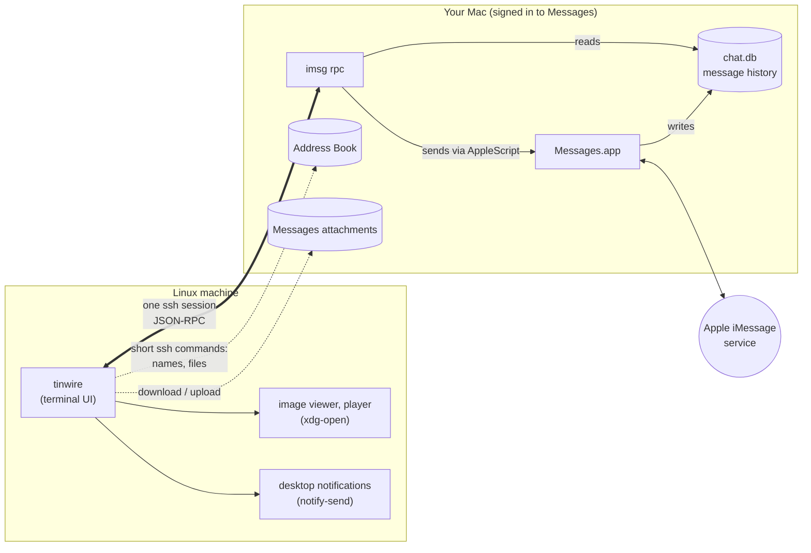
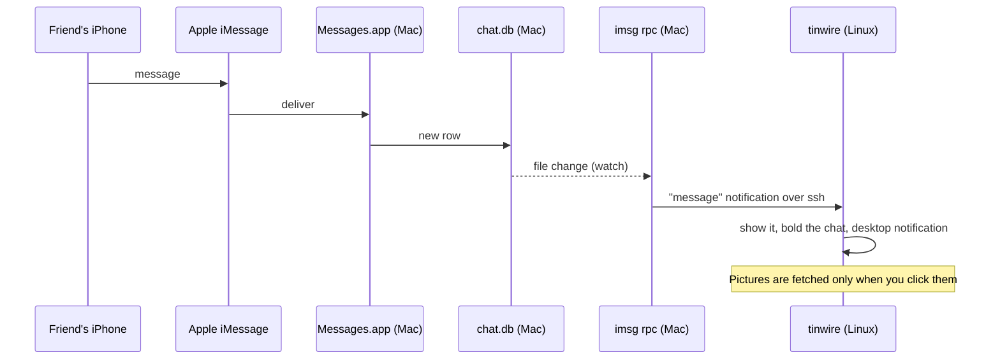
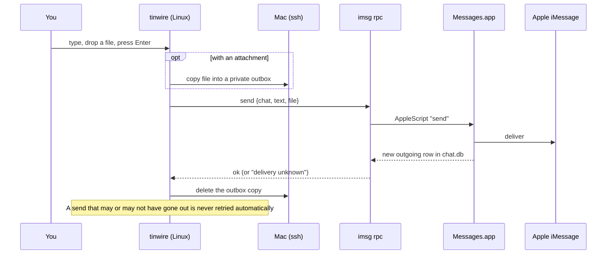

# tinwire

**iMessage on Linux, strung through your Mac.**

tinwire is a terminal iMessage client for Linux. It does not reimplement iMessage or log in to
Apple: it talks to the Messages app on a Mac you already own, over ssh, using
[`imsg`](https://github.com/openclaw/imsg)'s JSON-RPC mode. Think two tin cans and a wire: your
Linux machine on one end, your Mac on the other.

```
  Sam Rivera                  Sat│Sam Rivera · iMessage · +15550100
● Climbing crew               Sat│── Sat Oct 24 2026 ──
  Jordan Lee                16:10│ 13:30 Sam Rivera are you still up for tacos tonight?
● Jamie Park                  Wed│ 13:31 me yes! 7:30 at the usual place
                                 │ 13:40 Sam Rivera perfect, here's the new menu
                                 │                  📎 IMG_4021.HEIC (2.2 MB) · click to open
                                 │ 13:41 Sam Rivera reacted ♥ to "are you still up for tacos
                                 │                  tonight?"
                                 │ 13:42 me sent from my Linux box, by the way
                                 │
                                 │──────────────────────────────────────────────────────────────
                                 │on my way
                                 │
● connected to you@your-mac · imsg 0.19.1                                 ↵ send · ctrl+a attach
```

- **Nothing new is exposed.** No open port, no daemon, no cloud relay, no Apple ID on Linux.
  Everything travels over one ssh connection with key authentication.
- **SIP stays on.** Messages are sent through AppleScript, the way Messages is meant to be
  automated. Nothing is injected into Messages.app.
- **It feels like a chat app.** Mouse, drag-and-drop attachments, clipboard screenshots, contact
  names, unread markers, desktop notifications, live updates.

## How it works



tinwire starts `imsg rpc` on the Mac through ssh and keeps that one session open. `imsg` reads the
Messages database for chats and history, watches it for new messages, and sends by scripting
Messages.app. A few extra things (contact names, attachment downloads and uploads) are short ssh
commands. When you quit, the session closes and `imsg` exits.

### When a message arrives



### When you send



## Requirements

- **A Mac** that stays on, signed in to Messages, with Remote Login (ssh) enabled. Tested on
  macOS 26.
- **[imsg](https://github.com/openclaw/imsg) 0.19 or newer** on that Mac.
- **A Linux machine** with ssh access to the Mac. Optional: `notify-send` (notifications),
  `wl-clipboard` or `xclip` (copy and paste images), `xdg-open` (opening attachments).
- A terminal with mouse support. Tested with foot; kitty, Alacritty and Ghostty work too.

## Setup

### 1. On the Mac (once)

1. **Sign in to Messages** with your Apple ID, and send or receive one message so it is working.
2. **Install imsg 0.19+.** Either the official notarized release
   ([releases](https://github.com/openclaw/imsg/releases); keep the unzipped folder together, since
   the binary needs the bundles next to it, and symlink `imsg` into `/usr/local/bin`), or Homebrew:
   `brew install steipete/tap/imsg` (newer Homebrew may ask you to `brew trust` the tap first).
   Check with `imsg --version`.
3. **Turn on Remote Login**: System Settings → General → Sharing → Remote Login.
4. **Give ssh sessions Full Disk Access** so `imsg` can read the Messages database and tinwire can
   read contact names: System Settings → Privacy & Security → Full Disk Access → `+` → press
   `⌘⇧G`, enter `/usr/libexec/sshd-keygen-wrapper`, add it, and switch it on.
5. **Add your Linux machine's ssh key** to `~/.ssh/authorized_keys` on the Mac.

The first time you send a message, macOS asks whether ssh sessions may control Messages
("… wants to control Messages"). Someone has to click **Allow** on the Mac once.

### 2. On Linux

Install a release build:

```sh
# linux-amd64 or linux-arm64
curl -LO https://github.com/laddhebert/tinwire/releases/latest/download/tinwire-linux-amd64.tar.gz
tar -xzf tinwire-linux-amd64.tar.gz
install -Dm755 tinwire-linux-amd64/tinwire ~/.local/bin/tinwire
```

or with Go 1.24+: `go install github.com/laddhebert/tinwire@latest`, or from a clone: `make install`.

Tell tinwire where your Mac is:

```sh
mkdir -p ~/.config/tinwire
echo 'host = you@your-mac.local' > ~/.config/tinwire/config
```

`host` is any ssh destination that works without a password prompt, including a `Host` alias
from `~/.ssh/config`. Then check the whole chain (it prints counts only, never message content):

```sh
tinwire --check
```

It should end with `OK`. Then run `tinwire`.

## Using it

The chat list is on the left, the conversation on the right, the compose box below. The status
bar shows what just happened and the keys that apply where you are.

- **Unread chats are bold.** Opening a chat marks it read in tinwire (remembered across restarts).
- **Click** a chat to open it, a message to select it, the compose box to type. The wheel
  scrolls; scrolling to the top loads older messages.
- **Drag over the conversation to select text**; releasing copies it. Shift+drag uses your
  terminal's own selection instead.
- **Pictures and files**: click the `📎 … · click to open` line. iPhone photos (HEIC) and voice
  notes are converted on the Mac so they open on Linux.
- **Send files**: drag them onto the window or paste a screenshot with `ctrl+v`, and they are
  sent to the open chat straight away (type a caption first if you want one). `ctrl+a` and a path
  attaches without sending, so you can add text and press enter. Videos over the 100 MB limit are
  compressed automatically to fit (needs `ffmpeg`). `--no-send-on-drop` makes drops attach only.
- **New lines**: shift+enter (or alt+enter).

| Where | Key | Does |
|---|---|---|
| anywhere | `tab` | chat list → conversation → compose |
| anywhere | `ctrl+n` | new conversation: phone number, email or contact name |
| anywhere | `ctrl+r` | refresh; reconnect if disconnected |
| anywhere | `pgup` / `pgdn` | scroll |
| anywhere | `ctrl+c` | quit (`q` from the list or conversation) |
| chat list | `j`/`k`, `enter` | move, open |
| conversation | `j`/`k` | select messages; `k` at the top loads older history |
| conversation | `enter` / `o` | open the selected message's attachment |
| conversation | `s` | save the attachment to `~/Downloads` |
| conversation | `y` | copy the message text |
| conversation | `r` then `1`–`6` | tapback on the latest message (needs a permission, see Limits) |
| compose | `enter` | send |
| compose | `shift+enter`, `alt+enter`, `ctrl+j` | new line |
| compose | `ctrl+a` / `ctrl+v` / `ctrl+x` | attach a file / paste an image or files / remove attachments |

### Contact names

Names come from the Mac's address book automatically. To add or override one, put lines like
`+15551234567 = Mom` in `~/.config/tinwire/contacts`. Numbers match on their last 10 digits.

### Options

| Flag | Default | |
|---|---|---|
| `--host` | `host` in the config, or `TINWIRE_HOST` | ssh destination of the Mac (`local` runs imsg directly) |
| `--imsg` | `/usr/local/bin/imsg` (`imsg` in the config, `TINWIRE_IMSG`) | path to imsg on the Mac |
| `--dry-run` | off | never send, react or show typing |
| `--check` | | test the connection, print counts only, exit |
| `--chats`, `--history` | 100, 200 | chats listed; messages per history page |
| `--no-contacts`, `--no-notify`, `--no-typing`, `--no-mark-read`, `--no-mouse` | | turn a feature off |
| `--max-sends` | 0 (none) | optional cap on messages sent per run |
| `--timeout`, `--send-timeout` | 20s, 90s | per-call timeouts |
| `--cache-dir`, `--download-dir`, `--state-dir`, `--contacts` | XDG locations | where files go |
| `--debug-log FILE` | | log UI events (never message content) |

## Limits

These come from macOS, not tinwire. All of them still work for **incoming** messages: you see
reactions, replies, edits and unsends as they happen.

- **Marking chats read on the Mac and iPhone, threaded replies, editing and unsending your own
  messages, and tapbacks on older messages** need imsg's private-API bridge, which only runs with
  System Integrity Protection disabled. tinwire never uses it. It does track what you have read
  for itself.
- **Tapbacks on the latest message** work through Messages' UI, which needs Accessibility
  permission for ssh sessions on the Mac. That would let any ssh login control the Mac's desktop,
  so think twice. Without it, `r` tells you and nothing else is affected.
- **Typing indicators** are best effort on macOS 26 and switch themselves off if refused.
- No FaceTime, and nothing beyond what Messages on the Mac can do.

## Security

- Transport is ssh with key authentication only (`BatchMode=yes`). No ports are opened.
- Attachments are only read from the Messages attachment folder on the Mac. File names chosen by
  senders are sanitized, and only images, video, audio, PDF and plain text are opened
  automatically: anything else (a `.desktop` file, a script) is saved, never run.
- Uploads go to a private outbox on the Mac (mode 0600) and are deleted after sending.
- `--check` and `--debug-log` never print message content.

More in [docs/ARCHITECTURE.md](docs/ARCHITECTURE.md) and [SECURITY.md](SECURITY.md).

## Troubleshooting

Start with `tinwire --check`. Every status-bar message and common problem is explained in
[docs/TROUBLESHOOTING.md](docs/TROUBLESHOOTING.md).

## Why not BlueBubbles?

[BlueBubbles](https://bluebubbles.app) is the established option, with GUI clients. On macOS 26
its server could not send in its normal mode at the time of writing (chat IDs changed to
`any;-;…`), and its private-API mode requires disabling SIP. tinwire takes the narrow route:
`imsg` on the Mac, a terminal on Linux, ssh in between.

## Contributing

See [CONTRIBUTING.md](CONTRIBUTING.md). Changes are listed in [CHANGELOG.md](CHANGELOG.md).

## Credits

- [imsg](https://github.com/openclaw/imsg) by Peter Steinberger and contributors (MIT): the Mac
  side that does the real work.
- [Bubble Tea, Bubbles and Lip Gloss](https://github.com/charmbracelet) by Charm (MIT).

tinwire is not affiliated with Apple. iMessage is a trademark of Apple Inc.

## License

MIT, see [LICENSE](LICENSE).
